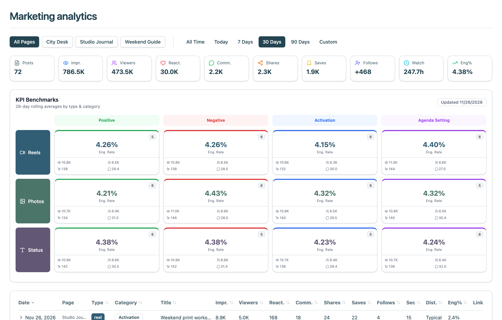

# Marketing Analytics Dashboard

See how a post performed, compare it with the last four weeks of similar content, and open the discussion behind the numbers.

[](docs/dashboard.png)

## Run locally

With Docker and Docker Compose installed, clone the private repository using an account with access.

```sh
git clone https://github.com/Dror-Bengal/marketing-analytics-dashboard.git
cd marketing-analytics-dashboard
docker compose up --build -d
```

Open [the dashboard on your computer](http://localhost:18787). The first run builds the app and loads 72 fictional posts across three pages into MongoDB. No service credentials are needed. To stop the app and keep your data, run `docker compose down`.

## Take a look

1. Choose **City Desk** or **Studio Journal** and change the date range. The totals and post list update together. The benchmark matrix always uses its own trailing 28-day window.
2. Choose **All Pages** and **All Time**, then sort the post table by impressions, reach or engagement. Expand **Weekend print workshop** to inspect the metrics and its sample comment analysis.
3. Use the post’s share control to open its detail view. Localhost links work on the same computer.

[](docs/comments.png)

The dashboard uses the original React screen and MongoDB aggregation pipelines. Every total in the preview is calculated from stored records. The sample analyses are prewritten so the first run works offline after installation.

## Work with your own data

Import a JSON array following [the example](examples/post.json). Use a stable `fb_post_id` to update an existing post. Watch time is in **seconds**, and timestamps include a UTC offset. Select **All Time** to see historical imports.

```sh
docker compose cp examples/post.json dashboard:/tmp/posts.json
docker compose exec dashboard python manage.py import /tmp/posts.json
```

For an empty workspace, use a separate database name and disable the seed when starting the stack. For example, run `SEED_DEMO=false MONGO_DATABASE=my_posts docker compose up -d`. Only the dashboard’s loopback port is published.

### Connect a Facebook Page (optional)

With a Page token, an API version supported by your Meta app, and permission to read that Page’s posts and comments, set `META_PAGE_TOKEN` and `META_GRAPH_VERSION` in your shell. Fetch the most recent batch:

```sh
docker compose exec -e META_PAGE_TOKEN -e META_GRAPH_VERSION dashboard python manage.py sync-page YOUR_PAGE_ID
```

This command reads up to 25 recent posts and the first 100 visible comment candidates per post, including available reaction, comment and share counts. Import a metrics export in the JSON format above to add reach, impressions and watch time. Some metrics in the interface default to zero when their source has not supplied a value. Refresh the browser after importing or syncing.

### Analyse a post with Gemini (optional)

Set `GEMINI_API_KEY` and `GEMINI_MODEL` in your shell to credentials and a model you can use. This explicit command sends the selected post text and its saved comments to Gemini. It saves the post classification, a short headline, recurring arguments and a qualitative sentiment summary. Refresh the dashboard to see the result.

```sh
docker compose exec -e GEMINI_API_KEY -e GEMINI_MODEL dashboard python manage.py analyze our-page-001
```

## Inside the repository

- [Dashboard and post detail](web/src/pages/Dashboard.tsx) · [benchmark matrix](web/src/components/KpiMatrix.tsx)
- [API queries and metric calculations](backend/app.py) · [sample data](backend/seed.py)
- [Data import and AI analysis](backend/manage.py) · [Facebook Page reader](backend/meta.py)

## Verify the data workflow

With the stack running, use `docker compose exec dashboard python -m unittest -v test_workflow`. The tests import into temporary MongoDB databases and exercise both provider adapters with local sample responses.
